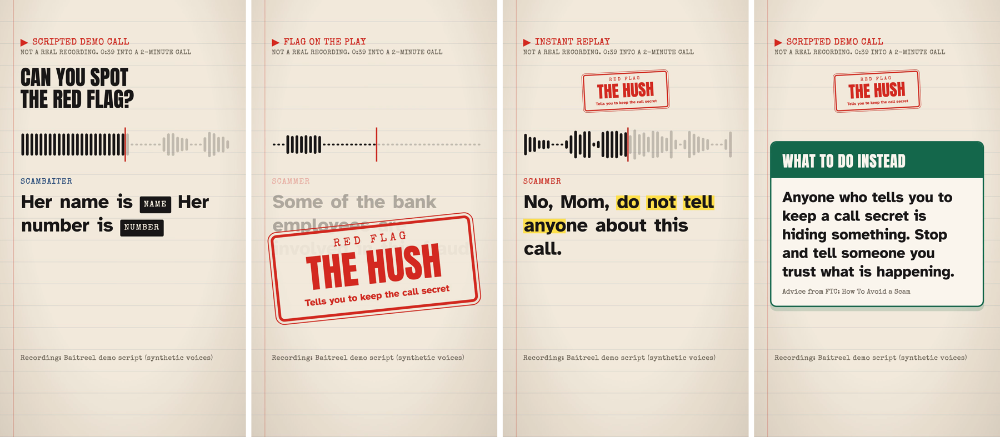

# Baitreel

**The highlight reel for your baits.**

Baitreel turns scambaiting call recordings into short, clearly labeled videos
that teach everyday people to recognize a scam while it is happening.

Scambaiters and anti-scam bots record thousands of hours of real scam tactics
in action. Almost nobody sits through a full call, so the teachable moments
stay buried. Baitreel finds them, cuts them into short vertical clips, names
the red flag, and tells the viewer what to do instead.



*Frames from the scripted demo call. The voices are synthetic and nothing in it is real.*

> **Status: early.** Milestone 1 works from the command line: one recording
> in, finished draft clips out, with a person approving each one. Milestone 2
> measures how good it is: you label a call by hand and Baitreel is scored
> against you. A web app for reviewing comes later. See [ROADMAP.md](ROADMAP.md) for what is next and
> [VISION.md](VISION.md) for why this exists.

## The promises

These are design constraints, not settings.

- **A human approves everything.** Baitreel suggests, drafts and renders. It
  has no upload feature and holds no account credentials. Approval needs a
  person at a keyboard who has played the whole clip.
- **It protects privacy.** Names, numbers, addresses and codes are bleeped
  from the audio and masked in the captions. Transcription and tactic
  spotting both run on your computer. Nothing is uploaded.
- **It respects creators.** It only works on local files you state you have
  the right to use, and it shows the source credit on every clip.
- **It is accurate and kind.** Advice comes from the
  [Field Guide](src/baitreel/fieldguide/README.md): human-readable cards with
  a cited source. No model writes safety advice, and no card may blame the
  people scammers target.

## Try it in five minutes

You need macOS or Linux, [ffmpeg](https://ffmpeg.org) and
[uv](https://docs.astral.sh/uv/).

```bash
git clone https://github.com/Jeff-Meendering/baitreel.git
```

```bash
cd baitreel
```

```bash
uv sync
```

```bash
uv run playwright install chromium
```

```bash
uv run baitreel doctor
```

`doctor` tells you if anything is missing. Then run the demo:

```bash
uv run baitreel demo
```

The demo reads a [scripted call](src/baitreel/demo/edna.yaml) aloud with
synthetic voices (Edna, her sourdough starter Gerald, and a caller from a
bank that does not exist), then runs the real pipeline on it. You get up to
four draft clips and a review prompt. Clips made from the demo are labeled as
a scripted demo on screen.

The first run downloads a speech model (about 460 MB).

### A better spotter (optional, recommended)

Out of the box Baitreel spots tactics with keyword patterns. It does much
better with a language model running on your own computer through
[Ollama](https://ollama.com):

```bash
ollama pull gemma4:12b
```

That model is about 8 GB and wants a machine with 16 GB of memory. Baitreel
uses it automatically when it is present. Set `BAITREEL_MODEL` to use a
different local model. Cloud-hosted models are refused on purpose.

## Use it on a real recording

Only use recordings you made, or have the creator's permission to use.

```bash
uv run baitreel cut path/to/recording.mp3 --credit "Your Channel Name"
```

Baitreel asks you to confirm your right to use the recording, then:

1. **Transcribes** it on your computer.
2. **Redacts** personal details: names, phone and card numbers, codes,
   addresses, emails and web addresses.
3. **Spots flags**: moments where a Field Guide tactic appears.
4. **Drafts and renders** a clip for the most teachable flags.
5. **Asks you to review** each clip. You play it, then keep it or throw it back.

Each clip you keep becomes a **publish kit**, a folder containing:

| File | What it is |
|---|---|
| `clip.mp4` | The vertical video, 1080 x 1920 |
| `caption.txt` | Suggested post text with the credit and the advice source |
| `credits.txt` | Who made the recording and where the advice comes from |
| `passport.json` | The approval record: who approved it, when, and what was redacted |

You upload it yourself, wherever you like.

### Useful options

| Option | What it does |
|---|---|
| `--allow WORD` | Keep a word that would otherwise be redacted, such as your persona's invented name. Repeat it for more words. |
| `--max-clips N` | Draft at most N clips (default 4). |
| `--spotter keywords` | Use the keyword spotter even if a local model is available. |
| `--no-speaker-labels` | Leave out the SCAMMER and SCAMBAITER tags if the model gets them wrong. |
| `--speech-model medium.en` | Use a larger, slower, more accurate speech model. |
| `--fresh` | Ignore saved work and start over. |

Other commands: `baitreel review` lists your baits and reopens a review,
`baitreel guide` prints the Field Guide, and `baitreel label` and
`baitreel eval` measure how well it works (next section).

Working files live in `~/Baitreel` (change it with `BAITREEL_HOME`), well
away from any Git repository.

## Measure it: a second opinion

Baitreel makes mistakes. To find out how many, a person labels a call by
hand, without seeing Baitreel's answers, and Baitreel is scored against them.

**Try it on the demo first.** The demo script carries its own answer key, so
after `baitreel demo` you can go straight to:

```bash
uv run baitreel eval
```

**Label a real call.** Label it *before* you cut it, so you cannot be swayed
by Baitreel's flags:

```bash
uv run baitreel label path/to/recording.mp3 --credit "Your Channel Name"
```

This transcribes the recording (only that) and opens a labeling page in your
browser. It runs on your computer and nowhere else. Play the call, read along,
and:

- select the words where the caller uses a tactic, then pick the tactic from
  the Field Guide list, and
- select **every personal detail you hear** (names, numbers, codes,
  addresses) and mark it. Trust your ears: if the transcript got the words
  wrong, press `[` and `]` while it plays to mark by time.

Labels are saved as you go. Press **Finish** when you have been through the
whole call. Only finished labels are scored. To reopen a call later, use its
bait id: `baitreel label BAIT_ID`.

**Prefer Audacity?** Add a label track, label each tactic by its name ("The
Hush") and each personal detail as `pii` (or `pii:name`, `pii:number`), then
File > Export > Export Labels, and:

```bash
uv run baitreel label BAIT_ID --import labels.txt --labeler "Your Name"
```

**Score it.** Cut the call as usual, then:

```bash
uv run baitreel eval
```

The report opens in your browser. It lives in `~/Baitreel/eval/`:

| File | What it is |
|---|---|
| `report.html` | Scores, charts and examples of disagreements. Prints cleanly. |
| `charts/*.svg` | Each chart on its own, ready to drop into a document |
| `scores.json` | Every number in the report |

It scores:

- **Flag spotting**, per tactic: precision (how many flags were right), recall
  (how many labeled moments were found) and F1, plus Cohen's kappa for
  overall agreement.
- **Redaction recall**: the share of hand-marked personal details that the
  bleeps fully cover. This is the number that matters most.

The report numbers calls and calls labelers "Labeler A", so it names no one,
and quotes in it are masked. Still read it before you share it.

**Compare models and prompts.** Every spotter's answer is saved with the
model and a fingerprint of its prompt, so earlier versions stay in the
report next to new ones. To add a local model to the comparison:

```bash
uv run baitreel eval --model gemma4:12b --model qwen3:8b
```

Each model takes minutes per call, one request at a time. If a second person
labels the same call, the report shows how well two people agree, which is
the realistic ceiling for any spotter.

## The clip format: Flag on the Play

Every clip has the same five beats, so a viewer who has seen one knows how to
read the next.

1. **The play.** The scammer's real line, with a little context.
2. **The flag.** A whistle, a freeze, and a stamp that names the tactic.
3. **The replay.** The line again, with the manipulative words highlighted.
4. **The counter-move.** What to do instead, from the Field Guide.
5. **The credit.** Whose recording it is.

## What it cannot do yet

Please read these before relying on it.

- **Redaction can miss things.** It works from the transcript. If the speech
  model mishears a name as an ordinary word, no rule will catch it. This is
  why approval requires playing the whole clip. Listen for names and numbers.
- **Flag spotting makes mistakes**, and the keyword spotter makes more. It
  cannot tell who is speaking. `baitreel eval` measures how often.
- **Speaker tags are a model's guess** from the text, not from the voices.
- **English only**, for now.
- **Field Guide cards are drafts** until a human reviewer has checked each one
  against its source. Review warns you when a clip uses a draft card.
- **No one has tested whether these clips change behavior.** The format is
  based on research into "prebunking" videos, which shows small but real
  effects for misinformation. See [VISION.md](VISION.md).

## How it is put together

```
recording -> transcribe -> redact -> spot flags -> draft -> render -> human review -> publish kit
```

| Module | What it does |
|---|---|
| `intake.py` | Registers a recording with a rights statement and a credit |
| `transcribe.py` | Local speech-to-text with word timings, split into lines at pauses |
| `redact.py` | Finds personal details to bleep and mask |
| `fieldguide/` | The tactic cards and their validation |
| `spot/` | Flag spotters: `local.py` (a local model) and `keywords.py` (the baseline) |
| `draft.py` | Turns a flag into the five beats of a clip |
| `stage/` | A web page that draws a clip for any moment in time |
| `render.py` | Builds the soundtrack, then films the stage page frame by frame |
| `review.py` | The human gate |
| `publish.py` | Writes the publish kit |
| `pipeline.py` | Runs the stages in order and reuses saved work |
| `labels.py` | Hand-made labels: label files, Audacity label tracks, the demo answer key |
| `labeling/` | The blind labeling page and the small local server behind it |
| `scoring.py` | Precision, recall, F1, Cohen's kappa and redaction coverage |
| `evaluate.py` | Gathers labels and spotter runs for each call and scores them |
| `report.py` | Writes the evaluation report and its charts |

Every stage saves plain JSON in the bait's working folder, so you can inspect
exactly what each step decided.

## Contributing

Baitreel is a student project that intends to stay maintained and welcoming.
A full contributor guide arrives before v0.1.0. Until then:

```bash
uv run pytest
```

```bash
uv run ruff check . && uv run ruff format --check .
```

The easiest first contribution needs no code: improve a
[Field Guide](src/baitreel/fieldguide/README.md) card, or add a tactic.

Never commit call recordings, transcripts of real calls, API keys or other
secrets. `python3 scripts/check_repo_hygiene.py` checks for them, and CI runs
it on every pull request.

## License

Code is released under the [MIT License](LICENSE). The Field Guide is
released under [CC BY 4.0](src/baitreel/fieldguide/LICENSE) so educators can
reuse it with credit. Bundled fonts keep their own
[open licenses](src/baitreel/stage/fonts/README.md).
